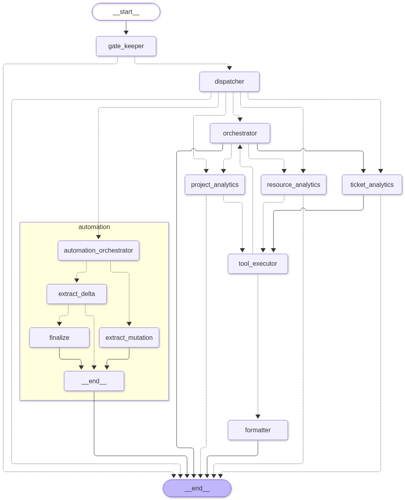
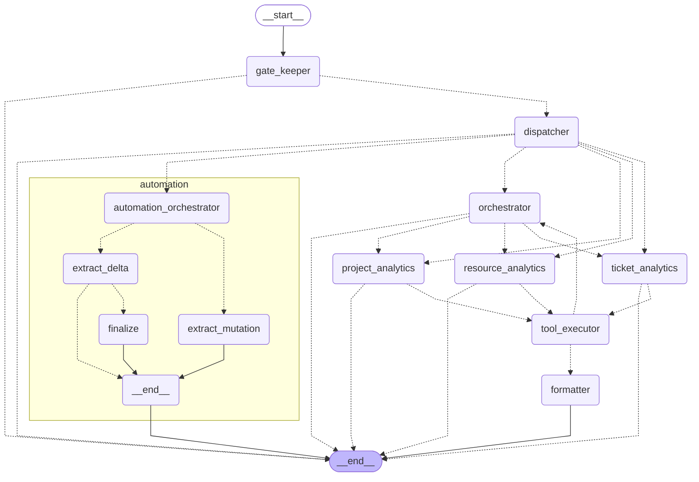

# Synlio Co-Pilot Architecture

Unified architecture diagram for the Synlio Co-Pilot AI engine.
Shows end-to-end request flow through GateKeeper, Intent Dispatcher, Automation Subgraph, and Analytics Subgraph.

